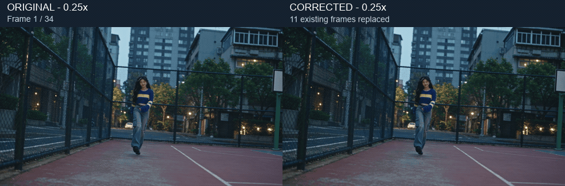
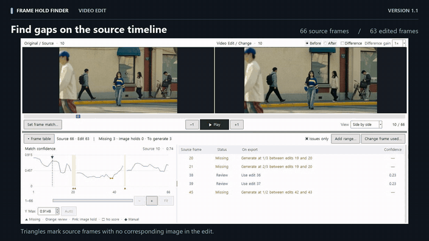
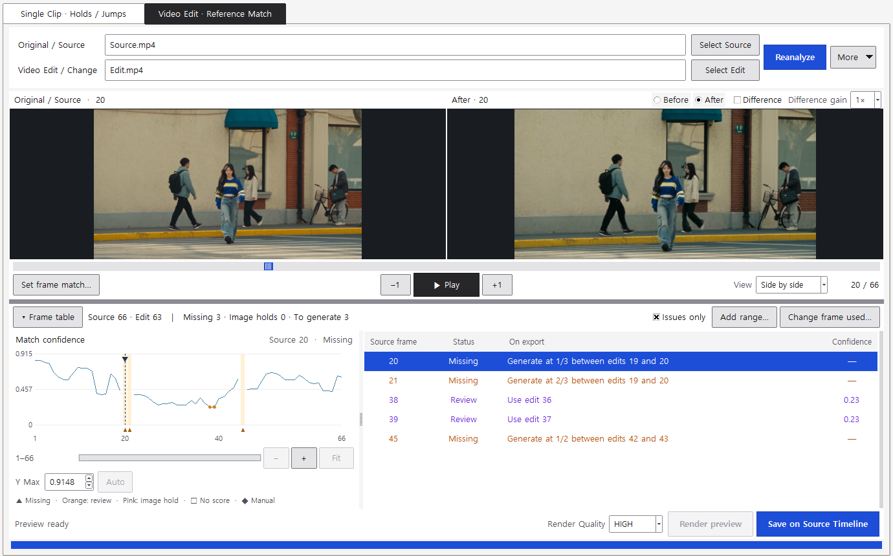
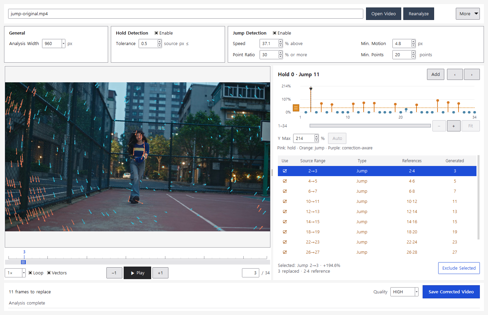
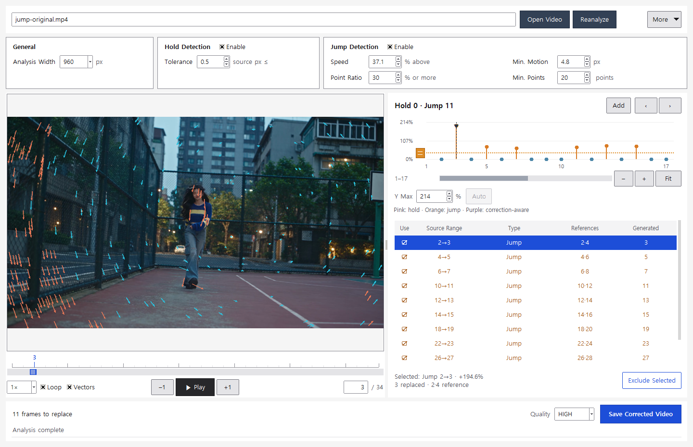

# Frame Hold Finder 1.1

[한국어](README.md) · [English](README.en.md)

Frame Hold Finder analyzes and corrects video timing on Windows. Choose **Single Clip · Holds / Jumps** to analyze motion in one clip or **Video Edit · Reference Match** to compare an edited shot against its original frame by frame.

[](docs/EXAMPLES.en.md)

## New in 1.1 · Video Edit reference matching

This is the car shot from FrameMatch. The red convertible in the original runs for 252 frames. The edit turns it into a yellow coupe and runs for 249 frames. Source frames 94 and 98 match edit frames 93 and 97. We used those two edited images to generate source frames 95, 96 and 97. The result keeps the edit’s ProRes format and plays on the original 252-frame timeline at 24 fps.

[](docs/media/video-edit-comparison.mp4)

[Watch the comparison](docs/media/video-edit-comparison.mp4) · [Download the sample clips](https://github.com/tardis7732/FrameHoldFinder/releases/download/v1.1/FrameHoldFinder-v1.1-Examples.zip)

<details>
<summary>View the reference matching interface</summary>



</details>

## Quick start

1. Download `FrameHoldFinder-v1.1-Windows.zip` from the [1.1 release](https://github.com/tardis7732/FrameHoldFinder/releases/tag/v1.1) and extract the entire archive.
2. Run **FrameHoldFinder.exe**. Analysis and playback work without the NVIDIA SDK.
3. Drop a video onto the path field or player, or type its path, then analyze it.
4. Review the graph and candidate list. Exclude unwanted corrections.
5. Follow [SDK setup](docs/INSTALL.en.md). In Single Video, choose `Render preview` to render the included corrections. Switch between `Before` and `After` in the player to inspect the same frame, then choose `Save Corrected Video` to save a file. Render a new preview after changing the replacement frames or their references.

Choose Korean or English under **More → Settings → Language**. Switching language keeps the loaded video and review state.

Choose `HIGH` (default), `MEDIUM` or `LOW` using `Render Quality` immediately to the left of `Render preview`. The selection applies immediately to previews and final exports in both modes and is saved for the next session.

## Features

| Feature | Behavior |
| --- | --- |
| Hold detection | Finds intervals with near-zero tracked motion. |
| Jump detection | Marks intervals where the same tracked points move faster than BOTH adjacent intervals. |
| Combined evaluation | Accounts for the motion expected from uniformly interpolating selected holds. |
| Review | Click to seek from frame 1 through the last frame; the wheel zooms time and the scrollbar pans. Adjust **Y Max** by typing, arrows, or Ctrl+wheel. **Auto** adds 10% headroom above the maximum; **Fit** restores the full time range and automatic Y scale. |
| Manual Add | Select two original reference frames and replace the existing frames between them. |
| Conflict handling | Disables automatic candidates that conflict with manual generated frames or protected reference frames. |
| CLI | Analysis, JSON reports, exclusions, manual ranges, SDK checks and rendering. |

The list shows **type, reference frames and generated frames**. Excluded or disabled rows leave the reference/generated columns blank. Consecutive jumps share a repair span, while each row shows its own target frames.

## Audio sync and correction strategy

Single Clip mode replaces frames in place. It keeps the source frame count and frame rate and copies the original audio streams to preserve timing.

Even for suspected dropped frames, the current approach redistributes an abrupt movement across the existing frames between surrounding references instead of extending the clip.

```text
Hold: frames 2 and 3 repeat → generate 3 from references 2 and 4
Jump: 3→4                 → generate 4 from references 3 and 5
Adjacent jumps: 3→4, 4→5  → generate 4 and 5 from 3 and 6 at 1/3 and 2/3
Manual Add: references 3,6 → replace existing 4 and 5; no insertion
```

This does not recover the actual missing camera frames or guarantee the original motion. Occlusion, rotation, cuts and long pauses can produce interpolation artifacts. Review the rendered result.

## Match the source format

FFmpeg export defaults to matching the supported **container, codec/profile, dimensions, frame rate, pixel format, sample aspect ratio and known color metadata**. The result is checked before publication. Unsupported combinations fail explicitly instead of silently switching codecs.

- Supported scope: SDR, constant frame rate and one video stream, using supported ProRes/H.264/HEVC combinations in MOV, MP4 or MKV. See [format limitations](docs/INSTALL.en.md#formats-and-limitations).
- Video is re-encoded: bitrate, file size and compressed bytes are not identical. NVIDIA interpolation uses **RGB10A2, 10-bit RGB**; a 12-bit ProRes output format does not imply 12-bit interpolation precision.
- The input is protected. Existing result files can be replaced after a temporary render passes validation.

## Detection defaults

| Setting | Default | Meaning |
| --- | --- | --- |
| Analysis width | 960 px | Tracking image width, capped at source width |
| Hold tolerance | 0.5 source px | Small motion treated as stationary |
| Speed threshold | +5% | Increase required over both neighboring intervals |
| Minimum movement | Analysis width × 0.005 | Initial value; adjustable in actual pixels |
| Track support | 30% | Minimum share of eligible points exceeding the threshold |
| Minimum tracks | 20 | Point count required in addition to the percentage |

All criteria are adjustable in the UI and CLI. Intentional pauses and acceleration can also be flagged. **A jump is a review candidate, not proof of a dropped frame.** Review edited sequences shot by shot.

## Real footage example





Seedance footage from the author's Higgsfield account is **trimmed to frames 111–144 of the previous example first**, then analyzed as a new **1–34 timeline**. At a **+37.1%** speed threshold, 11 detected jumps are corrected; reanalysis with the same settings changes the candidate count from **11 to 0**. No synthetic frame defects were added, and **34 frames / 24fps / about 1.417 seconds** remain unchanged.

The GIF above shows all 34 frames at **0.25x**. The application's default speed threshold remains **+5%**; only this example uses +37.1%. [Example notes and normal-speed comparison](docs/EXAMPLES.en.md) · [Download sample media](https://github.com/tardis7732/FrameHoldFinder/releases/latest)

**Hold example:** The **first 66 frames of a separate video** contain two holds and **two correction-aware jumps**, corrected together by replacing existing frames **15, 17, 63 and 65**. Reanalysis finds zero candidates of either type at the same settings, while **66 frames / 24fps and AAC audio** are retained. [Hold example and comparison](docs/HOLD_EXAMPLE.en.md)

## CLI

```powershell
.\FrameHoldFinder-CLI.exe analyze "D:\clips\input.mov" --report "D:\clips\analysis.json"
.\FrameHoldFinder-CLI.exe render "D:\clips\input.mov" -o "D:\clips\fixed.mov"
.\FrameHoldFinder-CLI.exe render "D:\clips\input.mov" -o "D:\clips\manual.mov" --manual-only --add 3:6
.\FrameHoldFinder-CLI.exe sdk-check --python "C:\vfx-env\Scripts\python.exe" --save
```

Use keys returned by `analyze`, such as `--exclude jump:3:4`, to exclude candidates. Repeat `--add` and `--exclude` as needed. `render --dry-run` prints a plan without rendering. See `--help` and the [CLI guide](docs/CLI.en.md).

## Video Edit · Reference Match

Select a forward-playing shot and its edit with the same framing. For comparison, the app aligns their display widths and vertical centers. It compares image tiles to match frames in temporal order using the timing algorithm adapted from FrameMatch for Nuke. [FrameMatch for Nuke](https://github.com/tardis7732/FrameMatch-for-Nuke/blob/b3fcfff/src/matcher.cpp)

The frame table opens with all source frames in one scrollable list. Both clips use frame numbers starting at 1. Select a row to compare the two images and see how that source frame will be filled on export. Collapse the table to give the graph more room.

- **Matched, Review or Manual match** — use the mapped edited image. For example, if original frame 155 maps to edited frame 153, output frame 155 uses edited frame 153.
- **Missing or Image hold** — when the gap has a distinct edited reference on each side, the NVIDIA SDK generates frames at equal intervals between them. A two-frame gap produces one frame one-third of the way between the references and another two-thirds of the way through. When both references cannot be established, the output uses the edited frame listed for that row.

After analysis, select two source rows whose edit images match and interpolate the frames between them. For example, suppose source frame 94 matches edit frame 93 and source frame 98 matches edit frame 97.

1. Select source frame 94 in the table and choose `Add range…`.
2. Select source frame 98. The range shows edit frames 93 and 97 as the references and source frames 95–97 as the three output positions. You can also select frame 98 first.
3. Choose `Apply range`. On preview or export, source frames 95, 96 and 97 use images generated one-quarter, one-half and three-quarters of the way between the two references.

To enter the edit frame numbers directly, choose `Enter edit numbers…` from `Add range…`. If an edit frame has several possible source positions, choose the position to use. To undo an added range, select one of its `Added` rows and choose `Remove added range`.

To replace a single output image, select its source row and choose `Change frame used…`. The graph shows how closely nearby edited frames match that source image. A lower cost means the visual features are more similar. A hollow circle marks the automatic match when available. Click a candidate to preview it, then choose `Use this frame`. For example, assigning edit frame 3 to source frame 28 puts that image at frame 28 of the output. Multiple rows can reuse the same edit frame. `Clear override` restores that row’s previous match or interpolation plan.

Matching and `Difference` align the clips to the same display width, accounting for their pixel aspect ratios. If their aspect ratios differ, the comparison uses the vertically centered overlap. For example, with a 1920×1080 source and a 1440×1080 edit, both with square pixels, the middle 1440×810 of the edit corresponds to the full source image.

Export uses the full edited picture at its native resolution. It re-encodes to the edit’s supported container, codec, profile and pixel format, using the source frame count, frame rate and audio. A silent source produces a silent export.

Use `View` to choose `Side by side`, `Source only` or `Edit only`. A single view fills the width of the player. Drag the horizontal divider between the player and the results to adjust the player height.

Choose `Render preview` to render the whole shot using the current frame plan. In the edit viewer, switch between `Before` and `After` to compare the mapped edit frame and the rendered result at the same source frame. Enable `Difference` to see the RGB difference between the source and the current edit image. Identical pixels appear black. `Difference gain` offers 1×, 2×, 4× and 8×.

Open the guide under `More` for graph symbols and a walkthrough of the export plan. `Reset Settings` restores the default view, graph range and frame table while preserving the analysis and manual edits. The same menu also provides settings, SDK setup, the last saved result and its folder, input paths and JSON export.

The preview is temporary. Render a new preview after changing an input, a match, an added range or a frame override. To keep the result as a video file, choose `Save on Source Timeline`.

The thin blue line in the lower-left graph shows match confidence across the shot. A pale amber band and a triangle mark each source frame with no corresponding frame in the edit. Click a triangle to visit that source frame. Orange dots mark frames to review and pink bands mark image holds. An open square indicates another unscored frame and a diamond marks a manual match.

Select `Set frame match…` to lock the source frame. As you step through the edit, the confidence graph keeps its current range and its playhead stays on the locked source frame. Compare the two images with `Difference`, then choose `Pin this pair` to recalculate the frame map using that pair. Use `Change…` to lock another source frame or `Unpin` to release a pair. Multiple pairs must preserve frame order in both clips.

Analyze up to one million original × edited frame pairs and 4,096 total frames per shot. Inspect the frame pairs when the composition or motion differs substantially.

## Development and license

See [source setup and build](docs/INSTALL.en.md#running-from-source). Verified on Windows 11 x64 / Python 3.11 / RTX 5070 Ti. [Validation](docs/VALIDATION.md) · [MIT license](LICENSE) · [Third-party components](THIRD_PARTY.md).

| Folder | Contents |
| --- | --- |
| `src/` | Application and CLI source |
| `tests/` | Automated tests |
| `scripts/` | Test runner and Windows build |
| `packaging/` | Icon, version metadata and PyInstaller configuration |
| `config/` | Example SDK configuration |
| `docs/` | Setup guides, sample media and third-party licenses |

This is not an official NVIDIA, Foundry or Higgsfield product. SDK and demo-media terms are separate from the application source license.
