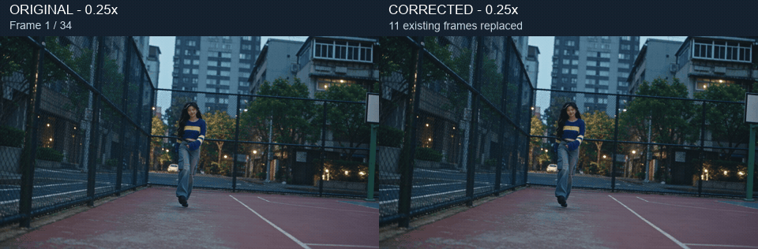
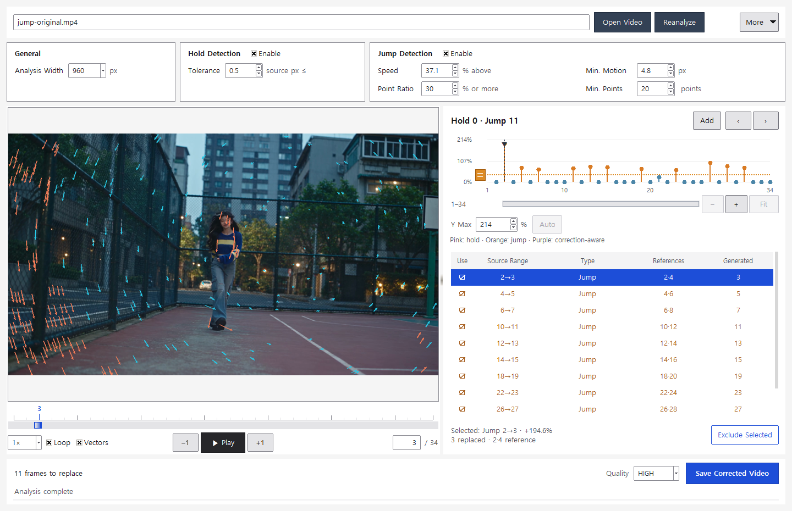
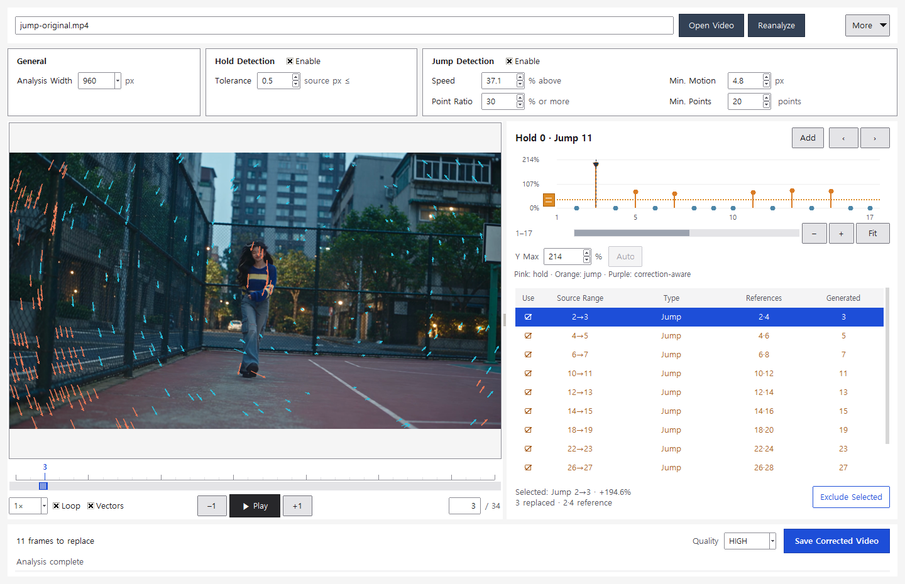

# Frame Hold Finder 1.0

[한국어](README.md) · [English](README.en.md)

**A Windows desktop tool for finding motion holds and jump candidates in a single video, without a separate reference original.** Review sparse optical-flow analysis, then replace selected frames with NVIDIA Video Effects SDK interpolation. No Nuke installation is required.

[](docs/EXAMPLES.en.md)



## Quick start

1. Download **FrameHoldFinder-v1.0-Windows.zip** from the [latest release](https://github.com/tardis7732/FrameHoldFinder/releases/latest) and extract the entire archive.
2. Run **FrameHoldFinder.exe**. Analysis and playback work without the NVIDIA SDK.
3. Drop a video onto the path field or player, or type its path, then analyze it.
4. Review the graph and candidate list. Exclude unwanted corrections.
5. Follow [SDK setup](docs/INSTALL.en.md) before saving corrected video.

Choose Korean or English under **More → Settings → Language**. Switching language keeps the loaded video and review state.

## Features

| Feature | Behavior |
| --- | --- |
| Hold detection | Finds intervals with near-zero tracked motion. |
| Jump detection | Marks intervals where the same tracked points move faster than BOTH adjacent intervals. |
| Combined evaluation | Accounts for the motion expected from uniformly interpolating selected holds. |
| Review | Click to seek from frame 1 through the last frame; the wheel zooms time and the scrollbar pans. Adjust **Y Max** by typing, arrows, or Ctrl+wheel. **Auto** adds 10% headroom above the maximum; **Fit** restores the full time range and automatic Y scale. |
| Manual Add | Select two original reference frames and replace the existing frames between them. |
| Conflict handling | Disables automatic candidates that conflict with manual generated frames or protected reference frames. |
| CLI | Analysis, JSON reports, exclusions, manual ranges, SDK checks and rendering. |

The list shows **type, reference frames and generated frames**. Excluded or disabled rows leave the reference/generated columns blank. Consecutive jumps share a repair span, while each row shows its own target frames.

## Audio sync and correction strategy

**Version 1.0 never inserts or deletes timeline frames.** It keeps the source frame count and frame rate, and copies the original audio streams to preserve timing.

Even for suspected dropped frames, the current approach redistributes an abrupt movement across the existing frames between surrounding references instead of extending the clip.

```text
Hold: frames 2 and 3 repeat → generate 3 from references 2 and 4
Jump: 3→4                 → generate 4 from references 3 and 5
Adjacent jumps: 3→4, 4→5  → generate 4 and 5 from 3 and 6 at 1/3 and 2/3
Manual Add: references 3,6 → replace existing 4 and 5; no insertion
```

This does not recover the actual missing camera frames or guarantee the original motion. Occlusion, rotation, cuts and long pauses can produce interpolation artifacts. Review the rendered result.

## Match the source format

FFmpeg export defaults to matching the supported **container, codec/profile, dimensions, frame rate, pixel format, sample aspect ratio and known color metadata**. The result is checked before publication. Unsupported combinations fail explicitly instead of silently switching codecs.

- Supported scope: SDR, constant frame rate and one video stream, using supported ProRes/H.264/HEVC combinations in MOV, MP4 or MKV. See [format limitations](docs/INSTALL.en.md#formats-and-limitations).
- Video is re-encoded: bitrate, file size and compressed bytes are not identical. NVIDIA interpolation uses **RGB10A2, 10-bit RGB**; a 12-bit ProRes output format does not imply 12-bit interpolation precision.
- The input is protected. Existing result files can be replaced after a temporary render passes validation.

## Detection defaults

| Setting | Default | Meaning |
| --- | --- | --- |
| Analysis width | 960 px | Tracking image width, capped at source width |
| Hold tolerance | 0.5 source px | Small motion treated as stationary |
| Speed threshold | +5% | Increase required over both neighboring intervals |
| Minimum movement | Analysis width × 0.005 | Initial value; adjustable in actual pixels |
| Track support | 30% | Minimum share of eligible points exceeding the threshold |
| Minimum tracks | 20 | Point count required in addition to the percentage |

All criteria are adjustable in the UI and CLI. Intentional pauses and acceleration can also be flagged. **A jump is a review candidate, not proof of a dropped frame.** Review edited sequences shot by shot.

## Real footage example



Seedance footage from the author's Higgsfield account is **trimmed to frames 111–144 of the previous example first**, then analyzed as a new **1–34 timeline**. At a **+37.1%** speed threshold, 11 detected jumps are corrected; reanalysis with the same settings changes the candidate count from **11 to 0**. No synthetic frame defects were added, and **34 frames / 24fps / about 1.417 seconds** remain unchanged.

The GIF above shows all 34 frames at **0.25x**. The application's default speed threshold remains **+5%**; only this example uses +37.1%. [Example notes and normal-speed comparison](docs/EXAMPLES.en.md) · [Download sample media](https://github.com/tardis7732/FrameHoldFinder/releases/latest)

## CLI

```powershell
.\FrameHoldFinder-CLI.exe analyze "D:\clips\input.mov" --report "D:\clips\analysis.json"
.\FrameHoldFinder-CLI.exe render "D:\clips\input.mov" -o "D:\clips\fixed.mov"
.\FrameHoldFinder-CLI.exe render "D:\clips\input.mov" -o "D:\clips\manual.mov" --manual-only --add 3:6
.\FrameHoldFinder-CLI.exe sdk-check --python "C:\vfx-env\Scripts\python.exe" --save
```

Use keys returned by `analyze`, such as `--exclude jump:3:4`, to exclude candidates. Repeat `--add` and `--exclude` as needed. `render --dry-run` prints a plan without rendering. See `--help` and the [CLI guide](docs/CLI.en.md).

## Roadmap

A **reference-original comparison workflow for Video Edit outputs** is planned. Like [FrameMatch for Nuke](https://github.com/tardis7732/FrameMatch-for-Nuke), it will compare original and edited frame correspondence to find drops, holds and timing changes. **This is not included in 1.0.** The current tool analyzes motion in one input video.

## Development and license

See [source setup and build](docs/INSTALL.en.md#running-from-source). Verified on Windows 11 x64 / Python 3.11 / RTX 5070 Ti. [Validation](docs/VALIDATION.md) · [MIT license](LICENSE) · [Third-party components](THIRD_PARTY.md).

This is not an official NVIDIA, Foundry or Higgsfield product. SDK and demo-media terms are separate from the application source license.
