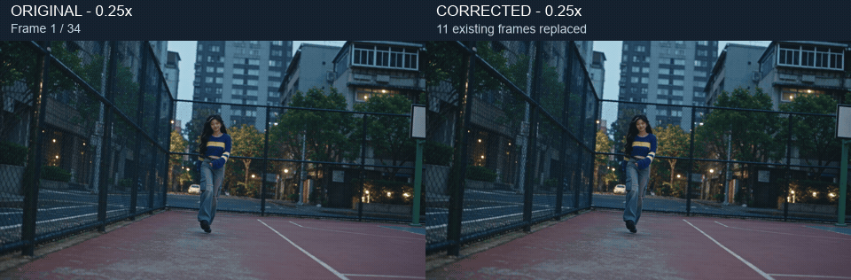
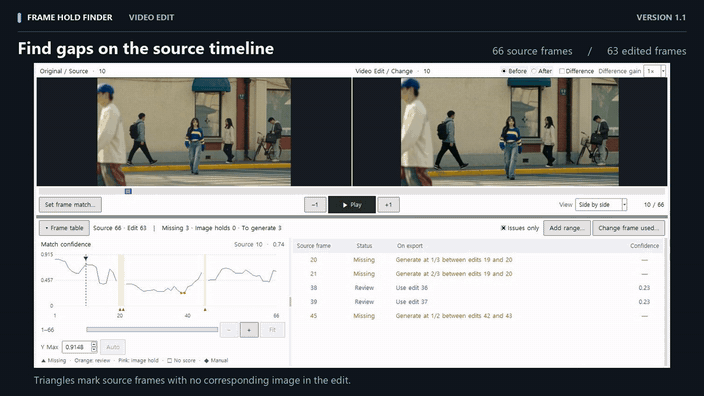
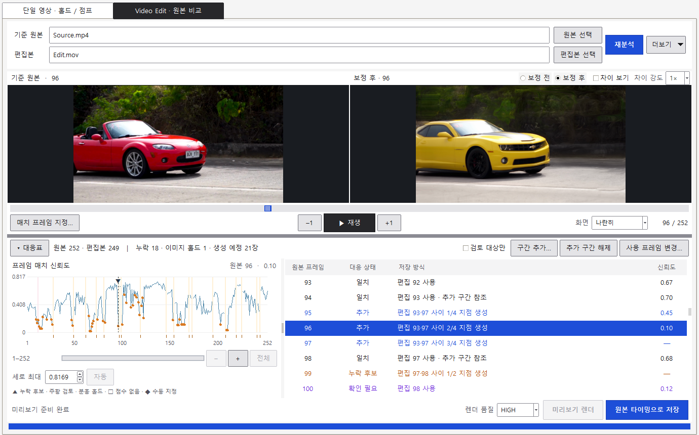
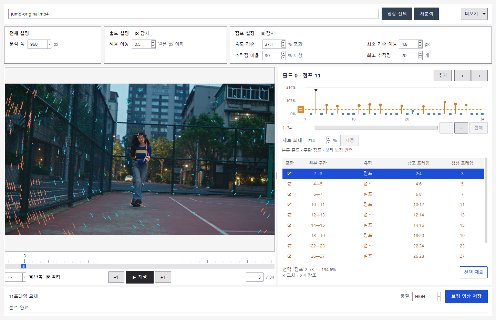
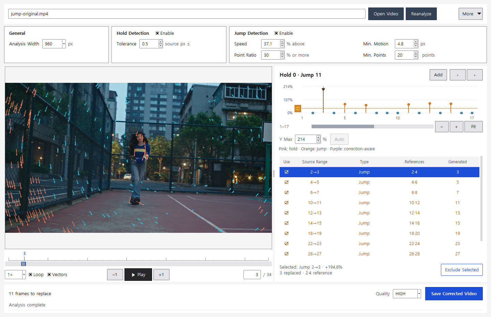

# Frame Hold Finder 1.1

[한국어](README.md) · [English](README.en.md)

Frame Hold Finder는 Windows에서 영상의 시간축을 분석하고 보정합니다. 상단에서 **단일 영상 · 홀드 / 점프** 또는 **Video Edit · 원본 비교**를 선택합니다. 기준 원본이 있으면 두 영상의 프레임 대응을, 생성 영상만 있으면 모션 벡터를 분석합니다.

[](docs/EXAMPLES.md)

## 1.1 추가 기능 · Video Edit 원본 비교

아래는 FrameMatch에서 사용했던 자동차 샷입니다. 빨간 컨버터블 원본은 252프레임, 노란 쿠페 편집본은 249프레임입니다. 원본 94번과 98번에 맞는 편집본 93번과 97번을 양끝으로 잡고, 원본 타임라인의 95·96·97번을 생성했습니다. 결과는 편집본의 ProRes 포맷으로 원본의 252프레임·24fps 타이밍을 따릅니다.

[](docs/media/video-edit-comparison.mp4)

[전체 비교 영상](docs/media/video-edit-comparison.mp4) · [따라 해 볼 예시 파일](https://github.com/tardis7732/FrameHoldFinder/releases/download/v1.1/FrameHoldFinder-v1.1-Examples.zip)

<details>
<summary>원본 비교 화면 보기</summary>



</details>

## 시작하기

1. [1.1 릴리스](https://github.com/tardis7732/FrameHoldFinder/releases/tag/v1.1)에서 `FrameHoldFinder-v1.1-Windows.zip`을 내려받아 전체를 압축 해제합니다.
2. **FrameHoldFinder.exe**를 실행합니다. 분석·플레이어는 NVIDIA SDK 없이 사용할 수 있습니다.
3. 영상을 위쪽 경로 입력란 또는 플레이어에 드롭하고 **분석**합니다. 경로를 직접 입력해도 됩니다.
4. 그래프와 목록에서 검토하고, 불필요한 항목을 제외합니다.
5. [SDK 설치 안내](docs/INSTALL.md)에 따라 SDK Python을 연결합니다. 단일 영상에서 `미리보기 렌더`를 누르면 포함된 보정 구간을 렌더합니다. 플레이어에서 `보정 전`과 `보정 후`를 바꾸며 같은 프레임을 비교한 뒤 `보정 영상 저장`으로 파일을 저장합니다. 교체할 프레임이나 참조 구간을 바꾸면 새 계획으로 미리보기를 다시 렌더할 수 있습니다.

**더보기 → 설정 → 언어**에서 한국어 / English를 전환할 수 있습니다. 열린 영상과 검토 상태를 유지합니다.

`미리보기 렌더` 바로 왼쪽의 `렌더 품질`에서 `HIGH`(기본값), `MEDIUM`, `LOW` 중 하나를 선택하세요. 선택 즉시 두 모드의 미리보기와 최종 저장에 적용되며 다음 실행 때도 기억합니다.

## 무엇을 하나요?

| 기능 | 동작 |
| --- | --- |
| 홀드 감지 | 추적점의 움직임이 거의 없는 반복 구간을 표시합니다. |
| 점프 감지 | 같은 추적점의 이동이 바로 앞·뒤 구간보다 모두 빠른 곳을 후보로 표시합니다. |
| 홀드와 점프 함께 평가 | 홀드 구간을 균등하게 보간했을 때의 속도를 계산에 반영합니다. |
| 검토 | 1프레임부터 마지막까지 표시하며, 클릭으로 프레임 이동, 휠로 시간축 확대, 가로 스크롤로 이동합니다. `세로 최대`는 숫자·화살표 또는 Ctrl+휠로 조절합니다. `자동`은 최댓값에 10% 여유를 두며, `전체`는 시간축 전체 범위와 세로축 자동 설정으로 되돌립니다. |
| 수동 추가 | 양끝 참조 프레임을 선택하면 그 사이의 기존 프레임을 균등하게 생성해 교체합니다. |
| 충돌 방지 | 수동 추가의 생성 프레임과 참조 프레임을 침범하는 자동 항목을 비활성화합니다. |
| CLI | 분석, JSON 보고서, 제외·수동 구간 지정, SDK 확인, 렌더를 지원합니다. |

목록에는 **유형 · 참조 프레임 · 생성 프레임**을 표시합니다. 제외되거나 비활성화된 항목은 참조·생성 칸을 비웁니다. 연속 점프는 하나의 생성 구간으로 묶되 각 행에는 해당 행의 생성 프레임을 보여줍니다.

## 오디오 싱크와 보정 방식

단일 영상 모드에서는 기존 프레임을 교체합니다. 총 프레임 수와 FPS를 유지하고 원본 오디오 스트림을 복사해 싱크를 유지합니다.

드랍이 의심되는 빠른 움직임도 길이를 늘려 채우는 대신, 앞뒤 정상 프레임 사이의 움직임을 기존 프레임들에 나눠 재구성합니다.

```text
홀드: 2·3이 반복 → 2·4를 참조해 3을 생성
점프: 3→4       → 3·5를 참조해 4를 생성
연속: 3→4, 4→5  → 3·6을 참조해 4·5를 1/3, 2/3 시점에 생성
추가: 3·6 선택   → 기존 4·5를 교체 (타임라인에 삽입하지 않음)
```

누락된 실제 촬영 프레임이나 정확한 원래 동작을 복원한다는 뜻은 아닙니다. 보간은 가림·빠른 회전·컷·긴 정지 구간에서 왜곡될 수 있으므로 결과를 확인하세요.

## 원본 포맷 유지 저장

기본값은 FFmpeg로 **원본 컨테이너, 코덱·프로파일, 해상도, FPS, 픽셀 형식, 픽셀 종횡비, 알려진 색상 정보**를 맞춰 재인코딩하는 것입니다. 지원하는 조합을 검증한 후 결과를 저장하며, 지원하지 않는 형식을 임의로 다른 코덱으로 바꾸지 않습니다.

- 지원 범위: SDR·고정 FPS·단일 영상 스트림, MOV / MP4 / MKV의 지원되는 ProRes·H.264·HEVC 조합. 상세 제한은 [설치와 형식 안내](docs/INSTALL.md#지원-형식과-제한)를 참고하세요.
- 재인코딩이므로 비트레이트·파일 크기·압축 바이트는 원본과 같지 않습니다. NVIDIA 생성 경로는 **RGB10A2, RGB 10비트**입니다. 12비트 ProRes 출력 형식이 12비트 정밀도 보간을 뜻하지는 않습니다.
- 원본 영상에는 저장할 수 없습니다. 기존 결과 파일은 검증을 통과한 임시 파일로 교체할 수 있습니다.

## 기본 분석 기준

| 설정 | 기본값 | 의미 |
| --- | --- | --- |
| 분석 폭 | 960 px | 분석용 영상 크기. 원본보다 확대하지 않음 |
| 홀드 허용 이동 | 0.5 원본 px | 같은 이미지로 볼 작은 움직임 |
| 속도 기준 | +5% | 같은 점이 앞·뒤 이동보다 모두 넘어야 할 비율 |
| 최소 기준 이동 | 분석 폭 × 0.005 | 초기값. 이후 실제 px 값으로 조절 |
| 추적점 비율 | 30% | 비교 가능한 점 중 기준을 넘을 최소 비율 |
| 최소 추적점 | 20개 | 비율과 함께 만족해야 할 최소 개수 |

모든 기준은 UI와 CLI에서 조절할 수 있습니다. 정지 장면과 의도적인 가속도 후보가 될 수 있습니다. **점프는 드랍 확정 판정이 아닙니다.** 컷을 포함한 긴 편집 영상은 샷별로 나눠 검토하는 편이 좋습니다.

## 실제 영상 예시





Higgsfield 계정의 Seedance 영상에서 기존 예시의 **111–144프레임을 먼저 잘라**, 새 **1–34프레임** 구간을 분석했습니다. 속도 기준 **+37.1%**에서 검출된 점프 11곳을 보정했고, 같은 기준으로 재분석한 후보는 **11 → 0**입니다. 프레임 결함을 인위적으로 넣지 않았으며 **34프레임·24fps·약 1.417초**를 유지합니다.

위 GIF는 전체 34프레임을 **0.25배속**으로 보여줍니다. 프로그램 기본 속도 기준은 **+5%**로 유지되며, 예시 분석에만 +37.1%를 사용했습니다. [예시 설명과 정상 속도 비교](docs/EXAMPLES.md) · [예시 다운로드](https://github.com/tardis7732/FrameHoldFinder/releases/latest)

**홀드 예시:** 별도 영상의 **처음 66프레임**에서 홀드 2곳과 **보정 반영 점프 2곳**을 함께 처리해 기존 **15·17·63·65프레임**을 교체했습니다. 같은 조건의 재분석에서 두 유형의 후보가 모두 0개였으며, **66프레임·24fps와 AAC 오디오**를 유지했습니다. [홀드 예시와 비교 영상](docs/HOLD_EXAMPLE.md)

## CLI

```powershell
.\FrameHoldFinder-CLI.exe analyze "D:\clips\input.mov" --report "D:\clips\analysis.json"
.\FrameHoldFinder-CLI.exe render "D:\clips\input.mov" -o "D:\clips\fixed.mov"
.\FrameHoldFinder-CLI.exe render "D:\clips\input.mov" -o "D:\clips\manual.mov" --manual-only --add 3:6
.\FrameHoldFinder-CLI.exe sdk-check --python "C:\vfx-env\Scripts\python.exe" --save
```

`analyze`의 키를 `--exclude jump:3:4`처럼 전달해 제외할 수 있습니다. `--add`와 `--exclude`는 반복 지정 가능합니다. `render --dry-run`은 생성 계획만 출력합니다. 자세한 옵션은 `--help`와 [CLI 안내](docs/CLI.md)를 참고하세요.

## Video Edit · 원본 비교


선택한 원본 96번에서 왼쪽은 원본, 오른쪽은 보정 후 편집본입니다. 아래 대응표에서 96번을 편집본 93번과 97번의 중간 지점으로 생성한 것을 확인할 수 있습니다.

원본과 편집본에서 같은 구도의 정방향 단일 샷을 선택하고 분석합니다. 비교할 때는 두 영상의 가로폭과 세로 중심을 맞춥니다. 화면을 여러 타일로 나눠 비교하고 시간 순서를 지키는 프레임 대응을 구하는 방식은 FrameMatch for Nuke의 타이밍 코드를 바탕으로 합니다. [FrameMatch for Nuke](https://github.com/tardis7732/FrameMatch-for-Nuke/blob/b3fcfff/src/matcher.cpp)

프레임 대응표는 첫 원본 프레임부터 마지막 프레임까지 한 목록으로 펼쳐집니다. 원본과 편집본 번호는 모두 1부터 시작합니다. 행을 선택하면 대응하는 두 영상을 보고 해당 프레임의 저장 방식을 확인할 수 있습니다. 그래프를 넓게 보려면 대응표를 접으세요.

- **일치 · 확인 필요 · 수동 지정** — 해당 행에 대응한 편집본 이미지를 그대로 사용합니다. 예를 들어 원본 155번에 편집본 153번이 대응하면, 결과물의 155번에는 편집본 153번이 들어갑니다.
- **누락 후보 · 이미지 홀드** — 구간 양쪽에 서로 다른 편집본 참조 프레임이 있으면 NVIDIA SDK가 그 사이를 균등하게 나눠 생성합니다. 예를 들어 두 장을 채울 때 첫 장은 두 참조 사이의 1/3, 다음 장은 2/3 위치에 생성합니다. 양쪽 참조를 확보할 수 없는 행은 표시된 편집본 프레임을 그대로 사용합니다.

분석 후 양끝의 매치가 맞는 구간을 찾으면, 원본 프레임 두 행을 골라 그 사이를 보간할 수 있습니다. 예를 들어 원본 94번에 편집본 93번이, 원본 98번에 편집본 97번이 맞는 경우 다음과 같이 지정합니다.

1. 목록에서 원본 94번을 선택하고 `구간 추가…`를 누릅니다.
2. 원본 98번을 선택합니다. 참조 이미지는 편집본 93·97번, 생성 위치는 원본 95–97번(3장)으로 표시됩니다. 98번부터 골라도 됩니다.
3. `구간 적용`을 누릅니다. `미리보기 렌더` 또는 최종 저장 시 원본 95·96·97번 자리에 각각 두 참조 사이의 1/4·1/2·3/4 지점 이미지를 생성합니다.

편집본 번호를 직접 지정하려면 `구간 추가…`에서 `편집본 번호로…`를 선택합니다. 한 편집본 프레임에 원본 위치가 여러 개면 사용할 위치를 고릅니다. 추가한 구간을 되돌리려면 결과 목록에서 `추가` 행 하나를 고르고 `추가 구간 해제`를 누릅니다.

한 자리만 다른 이미지로 채우려면 원본 행을 선택하고 `사용 프레임 변경…`을 누르세요. 이때 그래프는 고정한 원본과 주변 편집본 프레임의 매칭 비용을 보여줍니다. 선이 낮을수록 영상 특징이 비슷하고, 빈 원은 자동으로 매치된 편집 프레임을 가리킵니다. 그래프에서 후보를 미리 본 뒤 `이 프레임 사용`을 누르세요. 예를 들어 원본 28번에 편집본 3번을 지정하면 결과물의 28번에 그 이미지가 들어갑니다. 여러 행에서 같은 이미지를 쓸 수도 있습니다. `변경 해제`를 누르면 그 행에 있던 매치 또는 보간 계획이 복원됩니다.

분석과 `차이 보기`는 픽셀 종횡비를 반영해 두 영상의 표시 가로폭을 맞춥니다. 화면비가 다르면 세로 중심을 맞춘 뒤 양쪽에 겹치는 영역만 비교합니다. 예를 들어 원본이 1920×1080이고 편집본이 1440×1080인 정사각 픽셀 영상이라면, 편집본의 중앙 1440×810 영역이 원본 전체에 대응합니다.

저장할 때는 편집본 전체 화면과 해상도를 사용합니다. 지원하는 편집본의 컨테이너, 코덱·프로파일, 픽셀 형식으로 다시 인코딩하며, 프레임 수·FPS·오디오는 기준 원본을 따릅니다. 원본이 무음이면 결과도 무음입니다.

`화면`에서 `나란히`, `원본만`, `편집본만`을 선택합니다. 한쪽만 선택하면 그 영상이 플레이어 전체 너비에 표시됩니다. 플레이어와 결과 목록 사이의 가로 경계선을 위아래로 드래그하면 플레이어 높이를 조절할 수 있습니다.

`미리보기 렌더`를 누르면 현재 저장 방식대로 전체 샷의 보정 미리보기를 만듭니다. 편집본 화면에서 `보정 전`과 `보정 후`를 전환해 같은 원본 프레임에서 결과를 비교할 수 있습니다. `차이 보기`는 원본과 현재 편집본 화면의 RGB 차이를 보여줍니다. 같은 픽셀은 검정입니다. `차이 강도`에서 1×·2×·4×·8×를 고를 수 있습니다.

원본 비교의 `더보기 → 원본 비교 가이드`에서 그래프 기호와 프레임별 저장 방식을 확인할 수 있습니다. `설정 초기화`는 보기, 그래프 범위와 대응표를 기본 상태로 되돌립니다. 분석 결과와 직접 지정한 프레임은 유지됩니다. 같은 메뉴에서 설정, SDK 설정, 최근 결과와 결과 폴더를 열거나 입력 경로를 복사하고 대응표를 JSON으로 저장할 수 있습니다.

미리보기는 임시 파일입니다. 입력 영상, 프레임 대응, 추가 구간 또는 사용할 프레임을 바꾸면 미리보기를 다시 렌더하세요. 결과를 파일로 남기려면 `원본 타이밍으로 저장`을 선택합니다.

왼쪽 그래프의 가는 파란 선은 프레임별 매치 신뢰도를 보여줍니다. 편집본에서 대응 프레임을 찾지 못한 원본 위치에는 옅은 호박색 띠와 ▲가 표시됩니다. ▲를 누르면 그 원본 프레임으로 이동합니다. 주황 점은 검토할 프레임, 분홍 띠는 이미지 홀드입니다. 그 밖에 점수가 없는 프레임은 빈 사각형, 수동 지정은 마름모로 표시됩니다.

맞추려는 원본 프레임에서 `매치 프레임 지정…`을 누르면 원본이 고정됩니다. 편집본을 앞뒤로 넘겨도 신뢰도 그래프는 같은 범위를 보여주고, 커서는 고정한 원본 프레임에 머뭅니다. `차이 보기`로 두 이미지를 비교한 뒤 `이 쌍으로 지정`을 누르면 해당 쌍을 기준으로 대응표를 다시 계산합니다. 기준 원본을 바꾸려면 `변경…`을 누르세요. 여러 쌍은 두 영상에서 같은 순서여야 하며, `지정 해제`로 해당 쌍을 풀 수 있습니다.

분석 범위는 샷 하나당 원본 장수 × 편집본 장수 100만 쌍, 두 영상 합계 4,096프레임까지입니다. 장면 구성이나 움직임이 크게 달라진 경우에는 대응 이미지를 직접 검토하세요.

## 개발 및 라이선스

소스 실행·빌드는 [설치 안내](docs/INSTALL.md#소스에서-실행)에 있습니다. Windows 11 x64 / Python 3.11 / RTX 5070 Ti에서 확인했습니다. [검증 내역](docs/VALIDATION.md) · [MIT 라이선스](LICENSE) · [외부 구성요소](THIRD_PARTY.md).

| 폴더 | 내용 |
| --- | --- |
| `src/` | 앱과 CLI 소스 |
| `tests/` | 자동 테스트 |
| `scripts/` | 테스트 실행·Windows 빌드 |
| `packaging/` | 실행 파일 아이콘·버전·PyInstaller 설정 |
| `config/` | SDK 설정 예시 |
| `docs/` | 설치 안내·예시 영상·외부 라이선스 |

NVIDIA, Foundry, Higgsfield의 공식 제품이 아닙니다. SDK와 데모 영상은 프로젝트 소스 라이선스와 별개입니다.
