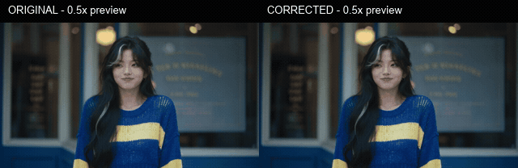

# Real footage example

[한국어](EXAMPLES.md) · [English](EXAMPLES.en.md) · [Home](../README.en.md)



[Normal-speed comparison](media/comparison-original-corrected.mp4) · [Download sample media](https://github.com/tardis7732/FrameHoldFinder/releases/latest)

## Input

The example uses **contiguous original frames 265–408** from an existing Seedance video downloaded from the author's Higgsfield account, renumbered 1–144. The excerpt was re-encoded to H.264 to reduce distribution size. No duplicated/inserted/deleted frames or retiming were introduced to manufacture a defect. It includes shot transitions, so peaks must not all be interpreted as frame loss.

- 1920×1080, 24fps, 144 frames, 6 seconds
- The excerpt and comparisons have **no audio**
- The GIF explicitly plays at **0.5x**; source/corrected MP4 files play at normal speed

## Same-settings analysis

Settings: width 960, speed +5%, minimum motion 4.8px, support 30%, minimum 20 points, hold tolerance 0.5px.

| Result | Before | Reanalyzed after correction |
| --- | ---: | ---: |
| Jump candidates | 20 | 0 |
| Hold candidates | 0 | 0 |
| Total frames | 144 | 144 |
| Frame rate | 24fps | 24fps |
| Duration | 6 seconds | 6 seconds |

Twenty existing frames were replaced. At the original candidate intervals, speed excess ranged from 15.51–194.30% before correction and 0–1.403% afterward. See the [analysis summary JSON](example-results.json).

**Zero candidates means the result no longer exceeds these detection settings.** It is not proof of recovering missing original frames or eliminating every visual artifact. Inspect faces, hands, occlusions and interpolation boundaries alongside the motion scores.


## Reproduce

Extract **FrameHoldFinder-v1.0-Examples.zip** from the release. Its `examples` folder contains the source excerpt, corrected video and comparison.

```powershell
.\FrameHoldFinder-CLI.exe analyze "examples\higgsfield-motion-original.mp4"
.\FrameHoldFinder-CLI.exe render "examples\higgsfield-motion-original.mp4" -o "examples\my-corrected.mp4"
.\FrameHoldFinder-CLI.exe analyze "examples\my-corrected.mp4"
```

This silent example does not demonstrate audio preservation. Separate audio-bearing short fixtures and a full 721-frame source were checked for copied audio and preserved frame count/FPS. [Validation](VALIDATION.md)
