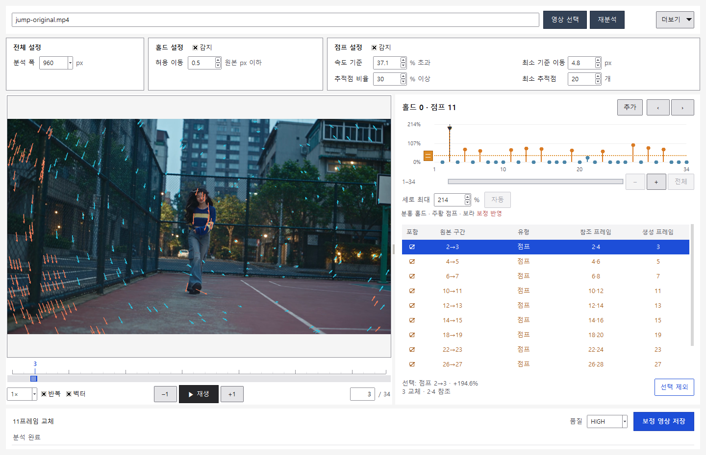

# 실제 영상 예시 — 점프 구간 보정

[한국어](EXAMPLES.md) · [English](EXAMPLES.en.md) · [처음으로](../README.md)


[전체 정상 속도 비교 영상](media/comparison-original-corrected.mp4) · [예시 파일 다운로드](https://github.com/tardis7732/FrameHoldFinder/releases/latest)

[홀드 구간 예시도 보기](HOLD_EXAMPLE.md)

비교 영상 오른쪽 보정본의 **주황 테두리는 교체된 프레임에서만 켜지며**, 프레임 번호와 누적 교체 수(**총 11장**)를 표시합니다. 다운로드용 `jump-corrected.mp4`에는 이 표시가 없습니다.

## 먼저 자르고, 다시 분석

작성자의 Higgsfield 계정에서 내려받은 Seedance 영상입니다. 기존 144프레임 예시의 **111–144프레임을 먼저 잘라** `jump-original.mp4`를 만들고, 이 **34프레임 파일을 새로 분석**했습니다. 전체 영상의 분석 결과를 잘라 사용한 것이 아닙니다.

- 원본·보정본: **1920×1080, 24fps, 34프레임, 약 1.417초**, 무음
- 새 번호 **1–34**에 **110을 더하면** 기존 예시의 **111–144**에 대응합니다.
- H.264 High / yuv420p로 저장했습니다. 선택 구간 안에 결함을 만들기 위한 프레임 복제·삽입·삭제·속도 변경은 하지 않았습니다.
- 위 GIF는 전체 34프레임의 **0.25배속 비교**입니다. 원본·보정본과 전체 비교 MP4는 정상 속도입니다.

## 검출과 교체

**속도 기준 +37.1%**로 분석해 점프 11곳을 검출했습니다. **프로그램 기본값은 +5%로 유지됩니다.** 나머지는 분석 폭 960, 최소 이동 4.8px, 유효점 30%, 최소 20점, 홀드 허용 이동 0.5px입니다.

교체 프레임(새 번호): **3, 5, 7, 11, 13, 15, 19, 23, 27, 29, 31**. 각 프레임을 바로 앞뒤 원본의 중간 이미지로 생성해 교체합니다. 예를 들어 **2→3 점프는 2·4를 참조해 3을 생성**하며, 기존 예시 번호로는 **112·114를 참조해 113을 생성**합니다.



| 결과 | 보정 전 | 같은 조건으로 재분석 |
| --- | ---: | ---: |
| 점프 후보 (+37.1% 기준) | 11 | 0 |
| 홀드 후보 | 0 | 0 |
| 첫 점프 2→3의 속도 초과율 | 194.561% | 0.631% |
| 총 프레임 | 34 | 34 |
| FPS | 24 | 24 |
| 길이 | 약 1.417초 | 약 1.417초 |

검출됐던 11개 구간의 보정 후 속도 초과율은 **0–0.876%**입니다. 이 결과는 위 +37.1% 설정에 해당합니다. 기본 +5%처럼 기준을 바꾸면 후보 결과도 달라질 수 있으며, 후보가 0이라는 사실만으로 실제 누락 프레임 복원이나 모든 시각적 결함의 해결을 보장하지 않습니다. [분석 요약 JSON](example-results.json)

## 재현

릴리스의 **FrameHoldFinder-v1.0-Examples.zip**을 풀면 `examples` 폴더에 `jump-original.mp4`, `jump-corrected.mp4`, 비교 영상이 있습니다. 원본은 이미 111–144 구간으로 잘라낸 파일입니다.

```powershell
.\FrameHoldFinder-CLI.exe analyze "examples\jump-original.mp4" --threshold 37.1
.\FrameHoldFinder-CLI.exe render "examples\jump-original.mp4" --threshold 37.1 -o "examples\my-corrected.mp4"
.\FrameHoldFinder-CLI.exe analyze "examples\my-corrected.mp4" --threshold 37.1
```

이 무음 예시는 오디오 검증용이 아닙니다. 별도의 오디오 포함 영상에서 복사와 프레임 수/FPS 유지를 확인했습니다. [검증 내역](VALIDATION.md)
