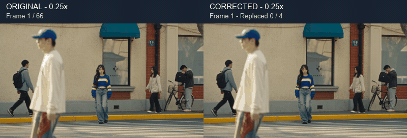
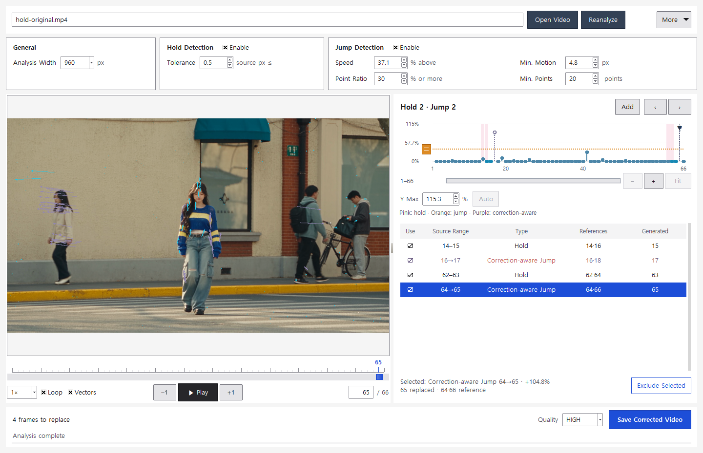

# Real footage example — correcting holds

[한국어](HOLD_EXAMPLE.md) · [English](HOLD_EXAMPLE.en.md) · [Home](../README.en.md) · [Jump example](EXAMPLES.en.md)



[Normal-speed comparison](media/hold-original-corrected.mp4) · [Download sample media](https://github.com/tardis7732/FrameHoldFinder/releases/latest)

In the comparison, the corrected view on the right shows an **orange border only on replaced frames**, alongside the frame number and cumulative replacement count (**4 total**). The downloadable `hold-corrected.mp4` has no overlays.

## Input and settings

The **first 66 frames of a separate Higgsfield video** from the author's account are extracted first and analyzed as `hold-original.mp4`. Frame numbers match that source. No frame duplication, insertion, deletion within the selected range or retiming was introduced to manufacture a defect.

- **66 frames at 24fps**, with a **2.75-second video timeline**
- **1920×1080, HEVC Main 10 / yuv420p10le and BT.709** retained
- **Both hold and jump detection enabled**
- Speed threshold **+37.1%**, width 960, minimum motion 4.8px, support 30%, minimum 20 points and hold tolerance 0.5px
- The application's default speed threshold remains **+5%**; this example uses +37.1%.
- The source excerpt and corrected file include audio. Comparison MP4 and GIF files are **silent**; the GIF shows the whole segment at **0.25x**.

## Ranges corrected together

Repeated ranges **14–15 and 62–63** are detected. After accounting for evenly interpolated motion through these holds, **16→17 and 64→65** still exceed the threshold and are included as **correction-aware jumps**. This is not a hold-only render.

| Type | Detected range | References | Generated/replaced frame |
| --- | --- | --- | --- |
| Hold | 14–15 | 14, 16 | 15 |
| Correction-aware jump | 16→17 | 16, 18 | 17 |
| Hold | 62–63 | 62, 64 | 63 |
| Correction-aware jump | 64→65 | 64, 66 | 65 |



Existing frames **15, 17, 63 and 65** are regenerated at the midpoint between their original references. No frames are inserted or deleted from the timeline. See the [analysis summary JSON](hold-example-results.json) for validation details.

| Result | Before | Reanalyzed with the same settings |
| --- | ---: | ---: |
| Hold candidates | 2 | 0 |
| Jump candidates (+37.1% threshold) | 2 — both correction-aware | 0 |
| Total frames | 66 | 66 |
| Frame rate | 24fps | 24fps |
| Video duration | 2.75 seconds | 2.75 seconds |

Speed excess at the two jump intervals falls from **89.257% to 0%** and **104.830% to 0.254%**. The AAC audio payload hashes also match. AAC packet boundaries make the container/audio duration **2.752 seconds**, which is unchanged after correction.

## Reproduce

The `hold-original.mp4` in **FrameHoldFinder-v1.0-Examples.zip** is already trimmed to the first 66 frames.

```powershell
.\FrameHoldFinder-CLI.exe analyze "examples\hold-original.mp4" --threshold 37.1
.\FrameHoldFinder-CLI.exe render "examples\hold-original.mp4" --threshold 37.1 -o "examples\my-hold-corrected.mp4"
.\FrameHoldFinder-CLI.exe analyze "examples\my-hold-corrected.mp4" --threshold 37.1
```

Correction-aware jumps are motion estimates that account for hold interpolation. They do not establish missing frames or exact reconstruction of the original action. Inspect faces, hands and occlusion boundaries in the generated result.
