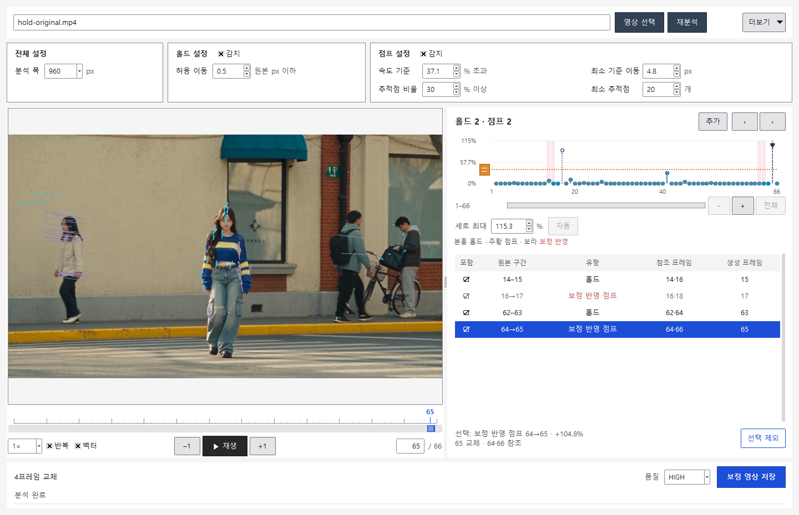

# 실제 영상 예시 — 홀드 구간 보정

[한국어](HOLD_EXAMPLE.md) · [English](HOLD_EXAMPLE.en.md) · [처음으로](../README.md) · [점프 예시](EXAMPLES.md)


[정상 속도 비교 영상](media/hold-original-corrected.mp4) · [예시 파일 다운로드](https://github.com/tardis7732/FrameHoldFinder/releases/latest)

비교 영상 오른쪽 보정본의 **주황 테두리는 교체된 프레임에서만 켜지며**, 프레임 번호와 누적 교체 수(**총 4장**)를 표시합니다. 다운로드용 `hold-corrected.mp4`에는 이 표시가 없습니다.

## 입력과 분석 조건

작성자의 별도 Higgsfield 영상에서 **처음 1–66프레임만 먼저 잘라** `hold-original.mp4`로 분석했습니다. 프레임 번호는 원본과 동일합니다. 선택 구간 안에 결함을 만들기 위한 프레임 복제·삽입·삭제·속도 변경은 하지 않았습니다.

- **66프레임·24fps**, 영상 길이 **2.75초**
- **1920×1080, HEVC Main 10 / yuv420p10le, BT.709** 유지
- **홀드 감지와 점프 감지 모두 활성화**
- 속도 기준 **+37.1%**, 분석 폭 960, 최소 이동 4.8px, 유효점 30%, 최소 20점, 홀드 허용 이동 0.5px
- 프로그램의 기본 속도 기준은 **+5%**이며, 이 예시에만 +37.1%를 사용합니다.
- 원본 발췌와 보정본은 오디오를 포함합니다. 비교 MP4와 GIF는 **무음**이며, GIF는 전체 구간의 **0.25배속**입니다.

## 함께 보정한 구간

반복 구간 **14–15, 62–63**을 검출했습니다. 홀드 구간이 균등하게 보간된다고 계산한 뒤에도 **16→17, 64→65**가 기준을 넘으므로, 이 두 곳은 **보정 반영 점프**로 함께 처리합니다. 홀드만 켜서 만든 예시는 아닙니다.

| 유형 | 검출 구간 | 참조 프레임 | 생성·교체 프레임 |
| --- | --- | --- | --- |
| 홀드 | 14–15 | 14·16 | 15 |
| 보정 반영 점프 | 16→17 | 16·18 | 17 |
| 홀드 | 62–63 | 62·64 | 63 |
| 보정 반영 점프 | 64→65 | 64·66 | 65 |



기존 **15, 17, 63, 65프레임**을 앞뒤 참조 이미지의 중간 시점으로 생성해 교체합니다. 타임라인에 프레임을 추가하거나 삭제하지 않습니다. 자세한 검증 수치는 [분석 요약 JSON](hold-example-results.json)에 있습니다.

| 결과 | 보정 전 | 같은 조건으로 재분석 |
| --- | ---: | ---: |
| 홀드 후보 | 2 | 0 |
| 점프 후보 (+37.1% 기준) | 2 — 모두 보정 반영 점프 | 0 |
| 총 프레임 | 66 | 66 |
| FPS | 24 | 24 |
| 영상 길이 | 2.75초 | 2.75초 |

두 점프 구간의 속도 초과율은 **89.257% → 0%**, **104.830% → 0.254%**로 줄었습니다. AAC 오디오 데이터의 해시도 전후 동일합니다. AAC 패킷 경계 때문에 컨테이너·오디오 길이는 **2.752초**로 표시되며, 이 값도 보정 전후 같습니다.

## 재현

릴리스의 **FrameHoldFinder-v1.0-Examples.zip**에 포함된 `hold-original.mp4`는 이미 처음 66프레임으로 잘라낸 파일입니다.

```powershell
.\FrameHoldFinder-CLI.exe analyze "examples\hold-original.mp4" --threshold 37.1
.\FrameHoldFinder-CLI.exe render "examples\hold-original.mp4" --threshold 37.1 -o "examples\my-hold-corrected.mp4"
.\FrameHoldFinder-CLI.exe analyze "examples\my-hold-corrected.mp4" --threshold 37.1
```

보정 반영 점프는 홀드 보간을 가정한 모션 평가입니다. 실제 누락 프레임의 확정 판정이나 원본 동작의 완전한 복원을 뜻하지 않으며, 보간 결과의 얼굴·손·가림 경계는 직접 확인해야 합니다.
